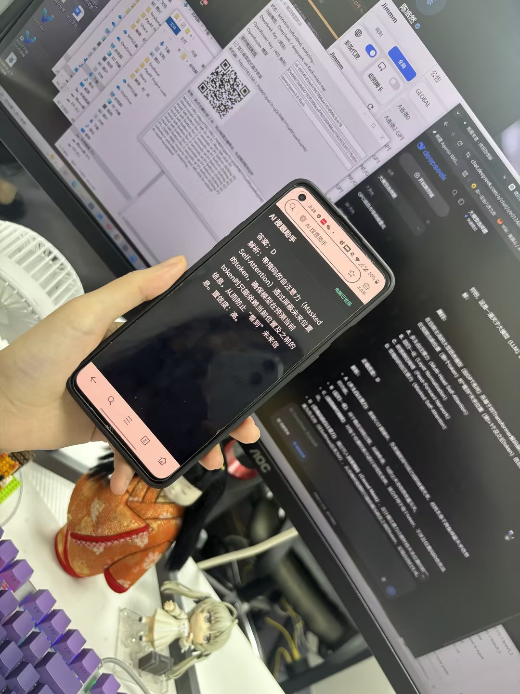
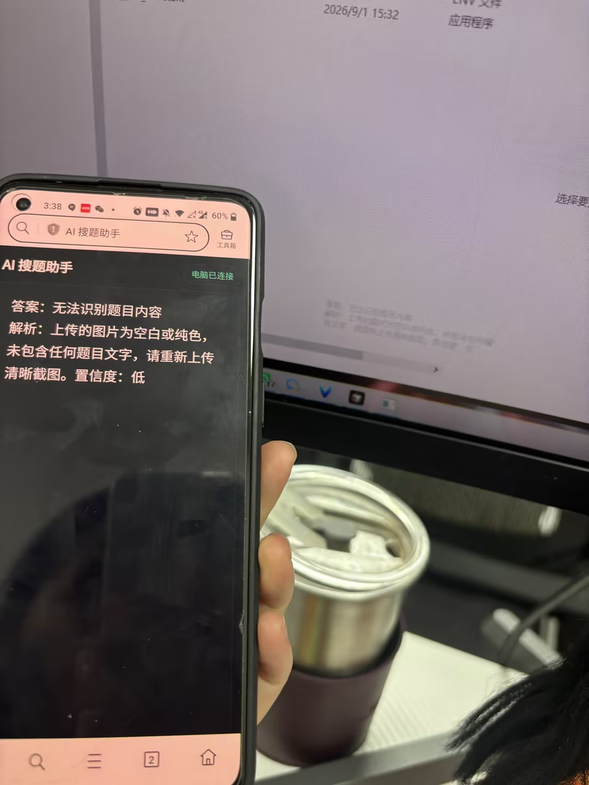

# AutoAIAnswer

Windows / macOS 截图搜题助手。通过全局鼠标手势框选屏幕题目，调用视觉模型分析，并把答案实时流式发送到同一局域网内的手机浏览器；也可选择在桌面显示轻量透明悬浮答案。

## 平台代码（已分开）

| 平台 | GitHub 分支 | 独立工程目录 | 捕获排除方式 |
|---|---|---|---|
| Windows | [`win`](https://github.com/SAYURIqvq/AutoAIAnswer/tree/win) | [`windows/`](windows/) | `WDA_EXCLUDEFROMCAPTURE` |
| macOS | [`mac`](https://github.com/SAYURIqvq/AutoAIAnswer/tree/mac) | [`macos/`](macos/) | `NSWindow.sharingType = .none` |

Mac 上打包只需要 `macos/` 目录：拷到 Mac 后执行 `./build.sh`。Windows 打包只需要 `windows/` 目录：执行 `build.bat`。

## 直接下载

[下载 Windows 版 AutoAIAnswer-Windows.zip](https://github.com/SAYURIqvq/AutoAIAnswer/releases/latest/download/AutoAIAnswer-Windows.zip)

[下载 macOS 版 AutoAIAnswer-macOS.dmg](https://github.com/SAYURIqvq/AutoAIAnswer/releases/latest/download/AutoAIAnswer-macOS.dmg)

无需安装 Python，下载对应系统版本后直接运行，并在软件界面中填写自己的 DeepSeek/OpenRouter API Key。公开发行版不包含作者的 API Key。

### 在 GitHub 页面中找到下载文件

1. 在仓库首页右侧找到 **Releases**。
2. 点击最新版本 **AutoAIAnswer v0.2.5**。
3. 进入发布页面后展开 **Assets**。
4. Windows 点击 **AutoAIAnswer-Windows.zip**；macOS 点击 **AutoAIAnswer-macOS.dmg**。

如果没有看到右侧栏，也可以直接点击上方的“下载 Windows 单文件版”链接，或打开 [Releases 页面](https://github.com/SAYURIqvq/AutoAIAnswer/releases/latest)。

## 核心体验

### 手机端实时查看

电脑完成框选后，模型返回的内容会立即逐段推送到手机浏览器，无需等待完整答案生成。手机端只保留一个清晰的输出区域，答案和解析连续显示，适合把电脑屏幕留给当前工作。

<table>
  <tr>
    <td width="50%"></td>
    <td width="50%"></td>
  </tr>
  <tr>
    <td align="center">手机与电脑配合，实时查看模型答案</td>
    <td align="center">电脑透明水印可以拖动调整透明度和大小</td>
  </tr>
</table>

### 轻量透明悬浮答案（水印效果）

桌面端可开启类似歌词或水印的答案悬浮层：文字小巧、低透明、始终置顶，并可拖动到任意位置。模型生成时内容会同步流式追加，不需要切换窗口。悬浮层默认关闭，可随时在主窗口中开启或隐藏，并自动记住上次位置。

> 悬浮答案是普通系统置顶窗口，可能出现在屏幕共享或录制画面中；本项目不提供规避录屏、共享屏幕或监控检测的功能。

## 功能

- 支持选择题、判断题、填空题、计算题和简答题；一图多题会按题号对应作答
- DeepSeek、OpenRouter 与豆包均可选，只需配置其中一把 Key 即可使用
- 手机和桌面选择「路线 + 模型」：豆包 `doubao-seed-1-6-vision-250815`、OpenRouter 通义千问 VL 235B Thinking / 32B、DeepSeek Flash
- 只使用中国模型（豆包 / DeepSeek / 通义千问），不会调用 GPT、Claude、Gemini 等国外模型
- 先走当前选中路线；该路线返回 HTTP 402 时再按 OpenRouter → DeepSeek → 豆包切换一次
- DeepSeek Key、OpenRouter Key、豆包 Key 和模型路线可在桌面界面保存
- 手机对话支持清空聊天并释放电脑端会话内存
- 左键长按 2 秒框选题目；右键长按 2 秒截取当前屏幕全屏（macOS 也可用 Control+左键，或窗口内「截取当前屏幕」）
- 手机二维码配对，答案与解析在单一输出框中实时流式显示
- 手机端可一键让电脑截全屏，也可输入追问后截全屏并发送给 AI，支持围绕同一截图任务连续追问
- 11px、约 18% 不透明度的水印式桌面悬浮答案，可拖动、置顶并记忆位置
- 模型生成期间暂停鼠标手势，避免误触

## 使用方式

1. 启动程序，至少填写一把 DeepSeek、OpenRouter 或豆包 Key 并保存，再选择要走的路线和模型。
2. 确保手机与电脑连接同一局域网。
3. 用手机扫描桌面窗口中的二维码并保持页面打开。
4. 框选题目：在起点按住左键至少 2 秒，松开后移动到终点，再普通单击一次左键。
5. 全屏截题：在题目所在屏幕按住右键 2 秒后松开；macOS 也可用 Control+左键长按，或点击窗口里的「截取当前屏幕」。
6. 手机端也可以点击「截全屏」让电脑立即截取当前屏幕；需要补充条件或追问时，在输入框写问题后点击「截全屏并提问」。
7. 程序截图并分析，多题会按题号对应输出；答案会实时显示在手机端，若开启悬浮答案也会同步显示在桌面。

Windows 首次运行可能询问防火墙权限，请允许程序访问“专用网络”，否则手机可能无法连接电脑的 8000 端口。

### macOS 首次运行

1. 打开 DMG，将 `AutoAIAnswer.app` 拖入“应用程序”。
2. 由于当前版本未使用 Apple Developer ID 签名，首次打开请在 Finder 中右键应用并选择“打开”。
3. 根据系统提示，在“系统设置 → 隐私与安全性”中允许 **辅助功能**（监听框选手势）和 **屏幕录制**（截取题目区域）。
4. 授权后若手势或截图仍不可用，请完全退出应用后重新打开。

## 模型切换规则

- 手机和桌面都可以选择具体路线和模型：豆包 `doubao-seed-1-6-vision-250815`、OpenRouter `qwen/qwen3-vl-235b-a22b-thinking` / `qwen/qwen3-vl-32b-instruct`、DeepSeek `deepseek-flash`。
- 没填对应 Key 的路线会显示「未配置 Key」，不会发请求。旧的「简单」档在没有 DeepSeek Key 时仍可回落到 `qwen/qwen3-vl-8b-instruct`。
- 先走当前选中路线；该路线返回 HTTP 402 且还有其他 Key 时，按 OpenRouter → DeepSeek → 豆包再试一次。
- 认证失败、限流、超时、网络错误和服务端错误不会自动切换，以免重复消耗额度。

## 从源码运行

需要 Windows 或 macOS，以及 Python 3.11 或更高版本。

Windows:

```powershell
python -m venv .venv
.venv\Scripts\Activate.ps1
python -m pip install -r requirements.txt
Copy-Item .env.example .env
python main.py
```

macOS:

```bash
chmod +x run_desktop.sh
./run_desktop.sh
```

也可以直接编辑界面中的 Key 并保存。`.env` 仅用于首次提供默认值，已被 Git 忽略。

## 配置

复制 `.env.example` 为 `.env`，按需设置：

```env
DEEPSEEK_API_KEY=
DEEPSEEK_MODEL=deepseek-flash
DEEPSEEK_BASE_URL=https://api.deepseek.com

OPENROUTER_API_KEY=
OPENROUTER_MODEL=qwen/qwen3-vl-235b-a22b-thinking
OPENROUTER_BASE_URL=https://openrouter.ai/api/v1
MODEL_TIER=good
```

不要提交真实 API Key。桌面界面保存的设置由 Qt `QSettings` 存储在当前系统用户配置中。

## 测试

```powershell
python -m pytest tests -q
```

## 构建单文件 EXE / macOS 应用

Windows:

```bat
build_windows_exe.bat
```

生成文件为 `dist\AutoAIAnswer.exe`。

macOS:

```bash
chmod +x build_macos.sh
./build_macos.sh
```

生成 `dist/AutoAIAnswer.app` 和 `dist/AutoAIAnswer-macOS.dmg`。GitHub Actions 会在打 `v*` 标签时构建并挂到 Release。公开构建不会嵌入本地 `.env` 或任何 API Key；用户首次启动后在界面中填写并保存自己的 Key。仓库已忽略 `dist/`、`build/`、`.env` 和 `*.spec`。

## 安全说明

- API Key 在用户要求下以明文形式显示和保存，请只在可信电脑上使用。
- 桌面悬浮窗是普通置顶窗口，可能出现在屏幕共享或录制内容中。
- 本项目不提供规避录屏、共享屏幕或监控检测的功能。

## License

当前仓库未附带开源许可证。未经作者明确授权，不代表允许复制、修改或再分发。
